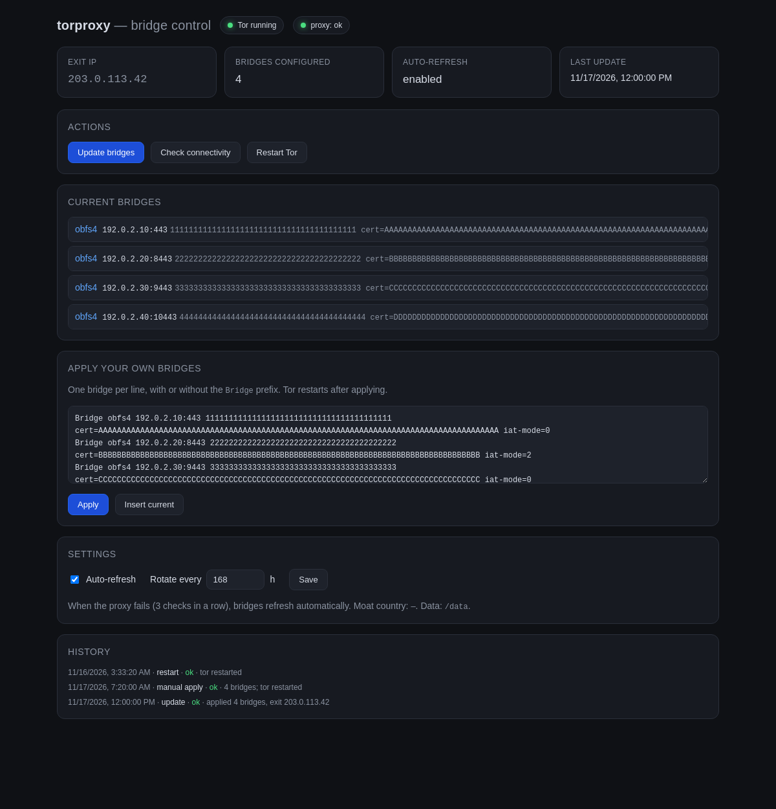

# 🧅 torproxy panel


[](https://github.com/yeswolf/torproxy-panel/releases/latest)

<p align="center">
  
</p>
<p align="center"><em>The panel after a successful update. Bridge lines in the screenshot are synthetic TEST-NET examples.</em></p>

**A self-hosted web panel that keeps obfs4 bridges fresh for a Tor + Privoxy container.**
It fetches candidates from the Tor Project, tests each one, applies the working set and
restarts Tor — no terminal, no manual bridge hunting.

A **Tor bridge panel** for censored networks: **obfs4**, **Moat**, **Privoxy**, **SOCKS5**,
**Docker**, **bridge rotation** and **self-healing** proxy health checks.

**Release:** [v1.0.0](https://github.com/yeswolf/torproxy-panel/releases/latest) ·
**Docs:** [docs/](docs/README.md) ·
**Source:** [github.com/yeswolf/torproxy-panel](https://github.com/yeswolf/torproxy-panel)

## ✨ What it does

- 🌉 **Automatic bridge rotation** — country-targeted Moat settings plus the built-in
  obfs4 list, deduplicated against what is already configured.
- 🧪 **Test before apply** — every candidate is tried in a throwaway Tor process; only
  bridges that build a circuit are written.
- 🔁 **Self-healing** — refresh on a timer or after repeated proxy health failures.
- 🧰 **Manual control** — paste your own bridges, restart Tor, run a health check and
  watch per-bridge progress.
- 🛡️ **Password protection** — HTTP Basic auth, with a generated password when none is
  configured.
- 🪶 **No dependencies** — Python standard library only, no database, no external
  assets at runtime.
- 🐳 **One compose file** — Tor, Privoxy, obfs4proxy and the panel in a single
  container.

## 🚀 Quick start

```sh
git clone https://github.com/yeswolf/torproxy-panel.git
cd torproxy-panel

# The container runs as tordocker (UID 102, GID 103).
mkdir -p data
sudo chown 102:103 data

docker compose up -d --build
```

Open <http://127.0.0.1:8099/>. The default user is `admin`. If you did not set
`PANEL_PASS`, read the generated password:

```sh
docker logs torproxy 2>&1 | grep 'generated panel password'
```

The proxy is then available on `127.0.0.1:9050` (SOCKS) and `127.0.0.1:8118` (HTTP).
All ports in the example bind to loopback; see [security](docs/security.md) before
exposing them.

## ⚙️ Configuration

The compose file contains a working example. The most used settings:

| Variable | Default | Meaning |
|---|---|---|
| `PANEL_PORT` | `8099` | Panel HTTP port inside the container. |
| `PANEL_USER` / `PANEL_PASS` | `admin` / generated | Basic-auth credentials. |
| `MOAT_COUNTRY` | empty | Country code for targeted Moat bridges. Empty uses the built-in list. |
| `TARGET_BRIDGES` | `4` | Number of working bridges to keep. |
| `REFRESH_HOURS` | `168` | Automatic rotation interval. `0` disables the timer. |
| `FAIL_THRESHOLD` | `3` | Consecutive health failures that trigger an update. |

Every variable, the HTTP API and the data layout: [docs/usage.md](docs/usage.md).

## 🧱 Stack

|  |  |
|---|---|
| 🐳 Base image | [`avpnusr/torprivoxy`](https://hub.docker.com/r/avpnusr/torprivoxy) — Tor, Privoxy, obfs4proxy, runit |
| 🧅 Tor | SOCKS on `9050`, HTTP proxy on `8118` |
| 🖥️ Panel | Python stdlib HTTP server on `8099` |
| 🌉 Bridges | obfs4 from the Tor Project Moat API, tested locally |
| 💾 State | `/data` — `bridges.conf`, `state.json`, `panel_password` |

How the processes and the update pipeline fit together:
[docs/architecture.md](docs/architecture.md).

## 📚 Documentation

| Guide | What's inside |
|---|---|
| [`docs/usage.md`](docs/usage.md) | Panel workflow, every setting, HTTP API, data files, troubleshooting |
| [`docs/security.md`](docs/security.md) | Exposure model, authentication, bridge handling, open-proxy risks |
| [`docs/architecture.md`](docs/architecture.md) | Container layout, supervision, bridge update pipeline |
| [`docs/README.md`](docs/README.md) | Documentation index and repository map |

## ⚠️ Known limitations

- Bridges are tested sequentially, so an update can take a few minutes.
- Only obfs4 bridges are requested and validated.
- The panel speaks plain HTTP; use a TLS reverse proxy for untrusted networks.
- A container restart cancels a running update; the applied bridge set is unaffected.

The full list and troubleshooting live in [docs/usage.md](docs/usage.md#limitations).

## 🙏 Credits

- [Tor Project](https://www.torproject.org/) for Tor, obfs4proxy and the Moat bridge
  API.
- [`avpnusr/torprivoxy`](https://hub.docker.com/r/avpnusr/torprivoxy) for the runtime
  image.
- Python standard library for the panel, the bridge tester and the HTTP server.

## 📄 License

No `LICENSE` file yet — usage conditions for the project's own code are not defined.
The base image and the Tor software keep their respective licenses.

⭐ If this keeps your proxy alive, a star helps other people find it.
